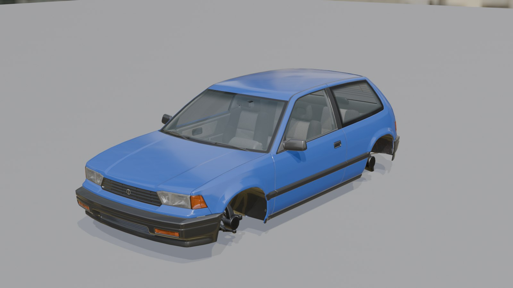
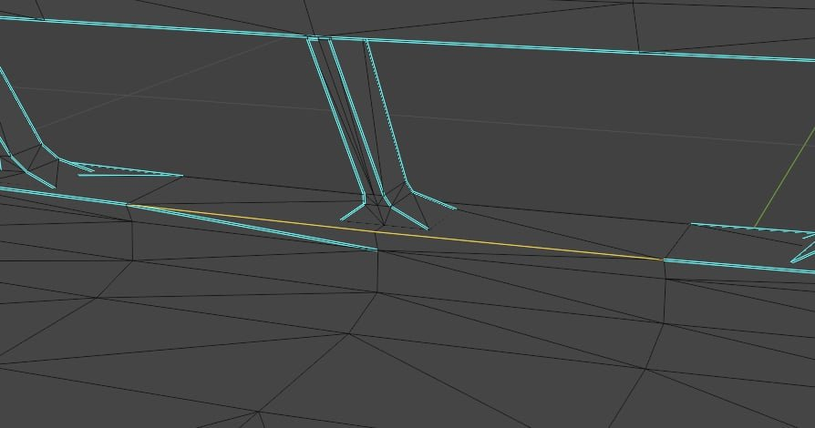
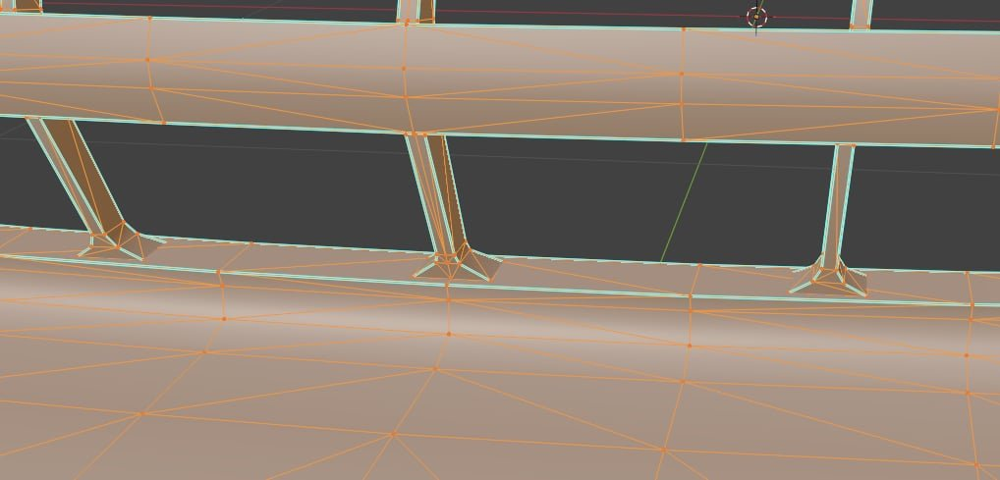
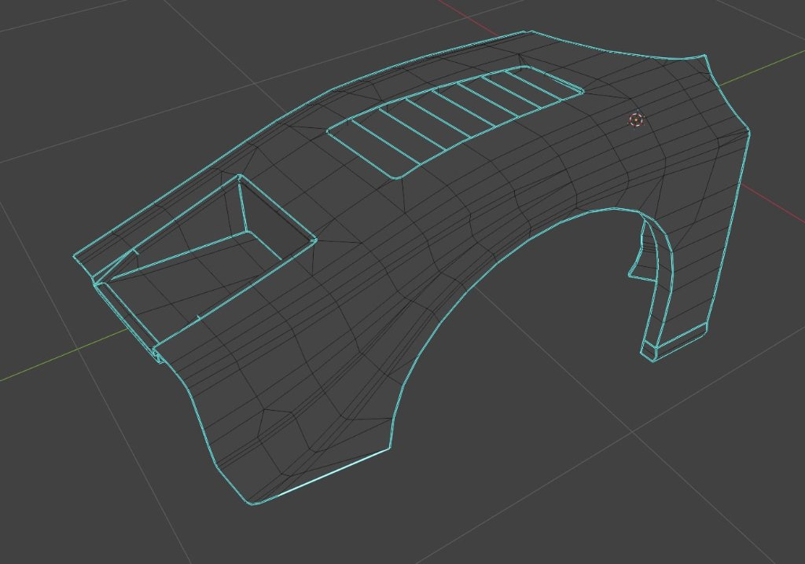

<div align="center">

# Collada (DAE) for Blender 5

Collada (`.dae`) import and export for Blender 5.0 and later, ported from Blender 4.5.1, with BeamNG.drive `.cdae` support and vehicle import from the game's zips.

[](https://github.com/likeBloodMoon/blender5-collada/actions/workflows/build.yml)
[](https://github.com/likeBloodMoon/blender5-collada/releases/latest)
[](https://github.com/likeBloodMoon/blender5-collada/releases)
[](https://www.blender.org)
[](LICENSE)



<sub>Covet DXi_M imported straight from the game's <code>covet.zip</code>: factory paint, layered materials, glass and lights (BeamNG Full PBR, 1.5.6). Rendered in EEVEE.</sub>

[Install](#install) · [Features](#features) · [Benchmarks](#benchmarks-and-tests) · [BeamNG](#beamng-drive) · [Roadmap](ROADMAP.md) · [Changelog](CHANGELOG.md)

</div>

Blender 5.0 removed the built-in COLLADA (`.dae`) importer and exporter. That broke game modding and engine pipelines that still run on `.dae`: BeamNG.drive, Second Life and OpenSim, Torque3D, Amnesia and others.

This extension is a full port of Blender 4.5.1's Collada I/O to Python, with the same `wm.collada_import` / `wm.collada_export` operators and options, so old scripts keep working. It also fixes bugs from the original and writes `.dae` files about half the size. For BeamNG.drive it reads and writes `.cdae` and can import a whole vehicle config straight from the game's zips.

| | Blender 4.5.1 built-in | **This add-on (1.5.5)** |
| --- | :---: | :---: |
| Works in Blender 5.0 / 5.1 / 5.2 / 5.3 | ✗ | ✓ |
| Same operators and options as 4.5.1 | ✓ | ✓ |
| `.dae` file size (2M-triangle mesh) | 517 MB | **259 MB** |
| Export time (2M-triangle mesh) | 7.8 s | **7.0 s** |
| Import time (5,000 objects) | 8.0 s | **~5 s** |
| Keeps custom normals through triangulation | ✗ | ✓ |
| Keep Quads (triangulate only n-gons) | ✗ | ✓ |
| BeamNG `.cdae` import and export | ✗ | ✓ |
| BeamNG vehicle import from `.zip` + `.pc` config | ✗ | ✓ experimental |

## Install

1. Download the zip for your system from [Releases](https://github.com/likeBloodMoon/blender5-collada/releases/latest):

   | System | File |
   | --- | --- |
   | Windows | `collada_io-1.5.5-windows_x64.zip` |
   | Linux | `collada_io-1.5.5-linux_x64.zip` |
   | macOS (Apple Silicon) | `collada_io-1.5.5-macos_arm64.zip` |
   | macOS (Intel) | `collada_io-1.5.5-macos_x64.zip` |
   | Any, no compiled code | `collada_io-1.5.5-pure-python.zip` |

2. Drag the `.zip` into Blender, or go to **Edit → Preferences → Get Extensions → ⌄ → Install from Disk…**
3. **Restart Blender after updating.** Blender keeps the old add-on code loaded until it restarts.

```bash
# or from the command line
blender --command extension install-file -r user_default -e collada_io-1.5.5-windows_x64.zip
```

Every release has a `SHA256SUMS.txt` to verify the download.

<details>
<summary><b>What is the optional native file (<code>fastfmt.dll</code> / <code>.so</code> / <code>.dylib</code>)?</b></summary>

<br>

The platform zips include a small C++17 helper that converts large number arrays to and from text, which roughly halves import and export time on big meshes.

The source is the ~125 lines in [`native/fastfmt.cpp`](native/fastfmt.cpp). It converts numbers in memory and does nothing else: no file access, no network, no system calls. GitHub Actions compiles every binary from this repository, with SHA-pinned actions, and the checksums are published with each release.

You don't need it. The pure-Python zip has no compiled code and writes byte-identical files, and `COLLADA_NATIVE=0` switches the helper off in any build.

</details>

## Features

<table>
<tr>
<td width="50%" valign="top">

### Collada `.dae`
- `<triangles>`, `<polylist>`, `<polygons>` with holes, `<trifans>`, `<tristrips>`, `<lines>`, n-gons
- Custom split normals, kept exactly through triangulation (**Keep Normals**)
- **Keep Quads**: triangulate only n-gons
- Multiple UV maps, vertex colors, multiple materials
- Modifiers at viewport or render settings
- Instancing, empties, deep hierarchies, negative scale
- `.zae`, `.kmz` and `.zip` archives, read in memory
- Drag and drop, **File** menus, Collection Exporters

</td>
<td width="50%" valign="top">

### Rigs, animation, scene
- Armatures, skinning, bone roll, bone collections
- Objects parented to bones
- Shape keys (`<morph>`)
- Object and bone animation, sampled or as keyframe curves, on Blender 5's slotted Actions
- Perspective and ortho cameras, and Point, Sun, Spot and Area lights
- OpenSim / Second Life export option
- **Mark Sharp from Normals** for clean creases on game meshes

</td>
</tr>
<tr>
<td width="50%" valign="top">

### BeamNG `.cdae` (v31)
- Import: static and skinned meshes, LODs, collision meshes, node hierarchy, exact game normals
- Three normal modes: exact game normals, sharp edges, or raw GPU vertices
- Export `[Experimental]`: static meshes, optional Zstandard compression
- Reads all 6,319 `.cdae` files shipped with BeamNG.drive 0.40.6 with 0 errors

</td>
<td width="50%" valign="top">

### BeamNG vehicles `[Experimental]`
- Open a vehicle `.zip` or folder and pick a `.pc` config
- Resolves the config's parts, `$variables` and `$=` expressions, and pulls shared parts from `common.zip`
- Textures from all `*.materials.json` files in the car and `common.zip`, with shared materials and one warning listing missing textures
- Parts tagged with slot, part and config, and an import report in the `.blend`

</td>
</tr>
</table>

## Benchmarks and tests

Measured on 26 Nov 2026: add-on 1.5.4/1.5.5 on Blender 5.3.0 against Blender 4.5.1's built-in Collada, Linux x64 on a 2-core VM, native helper on. Ranges are repeated runs; your machine will differ.

### Speed and file size

| Test | This add-on | Blender 4.5.1 |
| --- | :---: | :---: |
| Export, 1M-triangle mesh | 3.4-4.0 s | 3.6 s |
| Import, 1M-triangle mesh | 4.0-4.6 s | 3.5 s |
| Export, 2M-triangle mesh | **7.0 s** | 7.8 s |
| `.dae` size, 2M-triangle mesh | **259 MB** | 517 MB |
| Export, skinned 100k triangles with 64 bones | 0.6-0.8 s | |
| Export, 5,000 separate objects | 1.7-2.0 s | 0.8 s |
| Import, 5,000 separate objects | **~5 s** | 8.0 s |

Files are about half the size because repeated UVs and colors are written once instead of once per corner. Exporting a large mesh takes about as long as with the C++ original. Importing one is a little slower, and so is exporting thousands of small objects; both are on the roadmap.

Exporting thousands of separate objects got a lot faster in 1.5.4:

| Objects | 1.5.3 | 1.5.4 and later |
| ---: | :---: | :---: |
| 2,000 | 5.0 s | 0.6-0.7 s |
| 4,000 | 15.6 s | 1.2-1.4 s |
| 5,000 | 25.1 s | 1.7-2.0 s |

Without the native helper (pure-Python zip, or `COLLADA_NATIVE=0`) big meshes take about twice as long, and the files are byte-identical.

### Accuracy

Each test scene is built in Blender, exported, imported again and compared corner by corner (64 round-trip cases; a core set also runs in CI):

| What is checked | Covered |
| --- | --- |
| Vertex positions, hierarchies, negative scale | ✓ |
| Smooth, flat, sharp-edged and custom normals | ✓ |
| UV maps and byte vertex colors | ✓ |
| Armature rest pose, bone roll, skin weights | ✓ |
| Object and bone animation | ✓ |
| Cameras and lights | ✓ |
| `.cdae` normals vs the game's own files | 0.0000° median and p99 across 1,098,870 corners |

On every push, the legacy layout (`deduplicate_attributes=False`) is checked against Blender 4.5.1 itself: 19 export configurations with the same XML structure and float values within 1e-5, with and without the native helper.

### Robustness

| Test | Runs | Result |
| --- | :---: | --- |
| Export option combinations × test scenes | 882 | valid files, no broken references |
| Import option combinations | 567 | 0 failures |
| Hostile files: XXE, billion laughs, zip bomb, zip-slip | | refused, or nothing written outside the import |
| Malformed and truncated files | | clean error message, no crash |
| BeamNG game `.cdae` files | 6,319 | 0 parse errors |
| CI on every push | Blender 5.0.1 + 5.3.0 | 4.5.1 parity, deep verification, accuracy gate, fuzzing, archive tests |

## Usage

Use **File → Import → Collada (.dae, .zae, .kmz, .zip)** and **File → Export → Collada (.dae)**, the BeamNG `.cdae` entries next to them, or drop a file into the viewport.

From Python the calls are the same as in Blender 4.5.1:

```python
import bpy

bpy.ops.wm.collada_import(filepath="/path/to/model.dae")
bpy.ops.wm.collada_export(filepath="/path/to/out.dae", triangulate=True, keep_normals=True)

# BeamNG: import one vehicle config straight from the game's zip
bpy.ops.wm.collada_import(
    filepath=r"C:\...\BeamNG.drive\content\vehicles\etk800.zip",
    beamng_config="vehicles/etk800/<config>.pc",
    beamng_parts_mode="CONFIG",   # or "CONFIG_PLUS_HIDDEN" / "ALL"
)
```

### Tip: clean sharp edges on import

Game meshes often come in with missed creases and stray sharp edges from rounding noise. Turn on **Mark Sharp from Normals** under **Import Data Options**, and adjust **Sharp Threshold** (default 1°).

| Default import | With **Mark Sharp from Normals** |
| :---: | :---: |
|  |  |



## BeamNG.drive

Open a vehicle `.zip` (for example `content\vehicles\etk800.zip`) and the **Import BeamNG Archive** dialog lists its `.pc` configs. Pick one and choose what to import:

| Parts mode | What you get |
| --- | --- |
| Only this config | just the meshes the config uses |
| Config + other parts hidden | everything, with unused parts in excluded collections |
| Everything | every mesh in the archive |

Textures come from every `*.materials.json` in the car's zip and in `common.zip`. In testing, the ETK800 got 17 of 17 color textures and the Covet 34 of 34. A part that still needs its jbeam position goes into a **Needs placement** collection. With **Full PBR** (1.5.6), the car also gets its factory paint, ambient occlusion, clearcoat, layered trim and see-through glass, and headlights and indicators use their real light materials.

<details>
<summary><b>.cdae details and verification</b></summary>

<br>

- Format: v31 only (BeamNG.drive 0.40.x). Legacy v26 files are refused with a clear message.
- Import: `StandardMesh` and `SkinMesh` (armature, vertex groups, Armature modifier), `Quat16` node hierarchy, triangles, strips and fans, UV0/UV1, sRGB vertex colors, materials, LODs (highest only, or all levels in per-detail collections), optional collision meshes. Animation sequences are skipped with a notice.
- Normals modes:
  - Exact (default): welds GPU-split vertices and keeps the game's normals as custom normals (0.0000° median, 0.028° p99 round-trip error), and also marks hard edges sharp.
  - Sharp edges: turns creases into sharp edges, so shading updates as you edit.
  - Unmerged: raw GPU vertices, for debugging.
- Export `[Experimental]`: static meshes only, not yet confirmed in-game. BeamNG rebuilds `.cdae` from `.dae` on first load anyway, so `.dae` is still the recommended export for mods.
- Verification:
  - All 6,319 v31 files from BeamNG.drive 0.40.6 parsed with 0 errors (172 archives in 16 s, read-only).
  - Paired `.dae` vs `.cdae` on 396 objects: 0 m position error, max 0.04° rotation error (`Quat16`), exact UVs, ≤ 1/255 color difference, 100% material match.
  - Export round trip on the same 396 objects: 0 difference on every shape value, bounds, UVs and materials.
  - Game files are never committed. CI uses synthetic files only. See [`docs/cdae_format.md`](docs/cdae_format.md) and [`THIRD_PARTY_NOTICES.md`](THIRD_PARTY_NOTICES.md).

</details>

## What's next

| Version | Focus |
| --- | --- |
| 1.5.6 | BeamNG PBR materials: paint colors from the `.pc` through palette masks (liveries), ambient occlusion, clearcoat, see-through glass ([#52](https://github.com/likeBloodMoon/blender5-collada/issues/52)) |
| 1.5.7 | Correctness round: vertex color types, multiple rigs, shape keys, actions, Geometry Nodes instances |
| 1.6 to 2.0 | JBeam-aware vehicles: parts placed where the game puts them (wheels, steering wheels, props), BeamNG Check pre-export linter, material export |

The full plan is in [ROADMAP.md](ROADMAP.md).

## Building from source

```bash
blender --command extension validate io_scene_collada
blender --command extension build --source-dir io_scene_collada --output-dir dist
```

The code is split into small modules under `io_scene_collada/importer/` and `io_scene_collada/exporter/`. [`docs/architecture.md`](docs/architecture.md) maps each module to the Blender 4.5.1 C++ source it came from. See [CONTRIBUTING.md](CONTRIBUTING.md) for the dev setup and test suites.

## License

GPL-2.0-or-later. See [LICENSE](LICENSE). Based on Blender 4.5.1 LTS Collada I/O.
